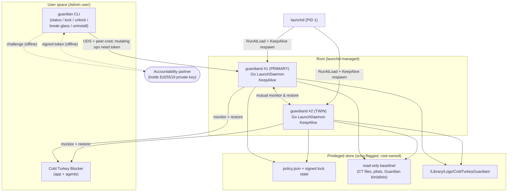
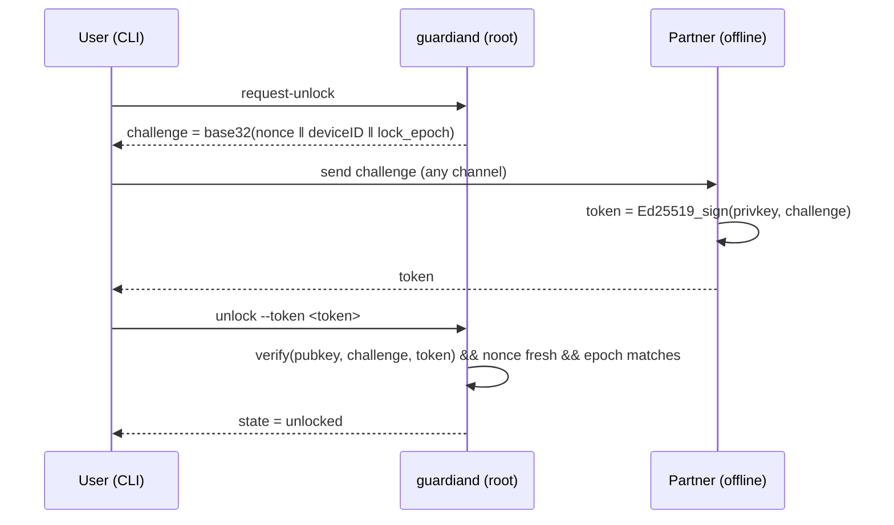
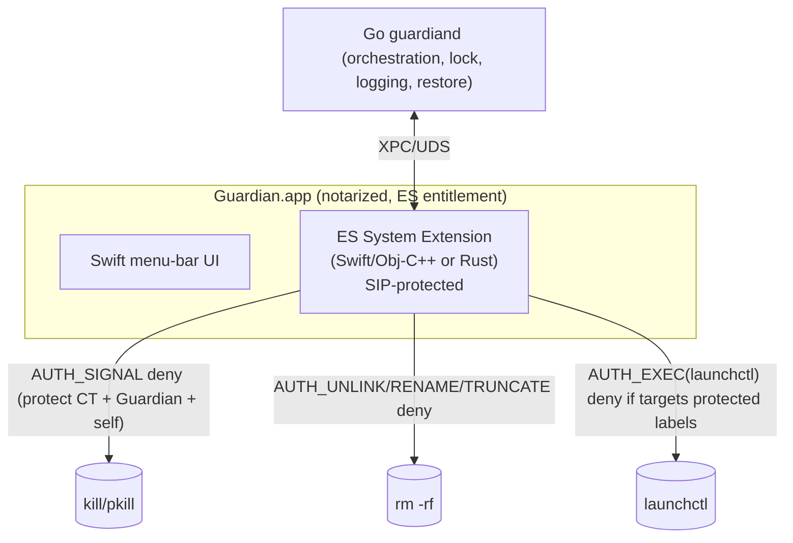

# Cold Turkey Guardian — High-Level Technical Specification

**Status:** Draft v1.0 (implementation-ready at a high level)
**Target platform:** macOS 14 Sonoma → macOS 26 Tahoe (Apple silicon + Intel)
**Primary author context:** single developer, Go/Rust/DevOps background

Every significant claim below is tagged:

- **[Fact]** — supported by Apple documentation, source code of real projects, or reproducible behavior found in research.
- **[Decision]** — an architectural choice made for this project.
- **[Assumption]** — plausible but *not yet verified*; must be tested before relying on it.

---

## 0. Decisions locked in from requirements interview

| Question | Answer | Consequence for architecture |
|---|---|---|
| Language stack | **Go daemon + CLI**, Swift UI later | Enforcement core in Go. A future Endpoint Security (ES) component **cannot** be hosted in Go and will be a separate Swift/Obj-C++ (or Rust) system extension. **[Fact]** |
| Daily account privilege | **User stays Admin** | The single strongest control (Standard account) is off the table. MVP delivers **friction + auto-reversal**, not a hard wall. A live root shell can ultimately win. **[Fact]** |
| Unlock model | **Accountability partner holds the key** | Lock/unlock gated by a partner-held cryptographic key (offline challenge–response). The easy "self-unlock" path is removed; only *destruction* remains for a solo relapse. **[Decision]** |

> **The core design pivot:** because you keep root, Guardian's job is not to be *unkillable* — it is to make every impulsive action **automatically reverse itself**, and to make the *only* clean exit require a person who is not you. Turning a 4-command, 30-second bypass into a deliberate, logged, multi-step teardown *is* the product.

---

## 1. Problem statement and goals

Cold Turkey Blocker is installed and works, but during an urge the user (who has admin/root) disables it in seconds using:

```bash
launchctl unload ~/Library/LaunchAgents/launchkeep.cold-turkey.plist
launchctl bootout gui/501 /Library/LaunchAgents/com.getcoldturkey.blocker.agent.plist
pkill -9 "Cold Turkey Blocker"
sudo rm -rf "/Library/Application Support/Cold Turkey"
```

**Goals**

1. Make that specific bypass path *self-healing*: each command is detected and reversed within seconds.
2. Add an **independently locked layer** whose lock cannot be released by the user alone (partner-held key).
3. Convert an *impulsive* bypass into an effortful, conspicuous, multi-step teardown that outlasts the urge.
4. Never permanently lock the user out of their own Mac; always provide a safe, slow recovery path.
5. Coexist cleanly with Cold Turkey; never corrupt its data or fight its own watchdog.
6. Be realistically buildable and maintainable by one developer.

**Success metric [Decision]:** a bypass attempt should cost **> ~10–15 minutes of deliberate, non-obvious effort** (or the partner's cooperation), reliably enough to break the impulse loop — not "be impossible."

---

## 2. Non-goals

- **Not** a replacement for Cold Turkey's blocking engine. Guardian never blocks sites/apps itself (MVP).
- **Not** DRM or anti-malware. It defends against *your future self*, a cooperative-but-impulsive adversary, not a skilled attacker trying to defeat it as a challenge.
- **Not** a guarantee against a determined root user or physical/Recovery-mode access. **[Fact]** Those always win on an owner-controlled Mac.
- **Not** dependent on MDM, Apple Business, or a wiped/re-enrolled machine (MVP).
- **Not** reliant on disabling SIP or raising `kern.securelevel` (rejected on stability/lockout grounds). **[Decision]**

---

## 3. Threat model

**Adversary:** the owner, mid-urge — has admin password and `sudo`, is willing to spend a few minutes, prefers the path of least resistance, and is *not* pre-planning an elaborate defeat while calm.

| Capability | Available to adversary? | Guardian's answer |
|---|---|---|
| Run the 4 known commands | Yes | Detect + auto-reverse (§24) |
| `pkill`/`kill -9` Guardian | Yes | launchd `KeepAlive` respawn + twin restores it (§16, §25) |
| `launchctl bootout` Guardian daemon | Yes (root) | Twin daemon re-bootstraps it; plist restored from `schg` backup |
| `rm -rf` Guardian files/binary | Yes (root, after clearing `schg`) | Twin restores from read-only baseline; `schg` adds a step |
| Edit `policy.json` to "unlocked" | Yes | **Ineffective** — unlock requires a partner-signed token, not a flag (§18, §23) |
| Methodically dismantle *both* twins + baseline in the correct order, fast | Yes | **Wins.** Accepted; it is slow, multi-step, and conspicuous (§8, §33) |
| Reboot to Recovery, delete everything / reset admin | Yes | **Wins.** Accepted; deliberate, ~minutes, self-aware relapse (§8) |
| Obtain the partner's key without the partner | No (by construction) | The intended wall for a *solo* relapse |

**Explicitly out of scope:** kernel exploits, someone else attacking the machine, data exfiltration.

---

## 4. User stories

- *As the user*, when I run any of my four habitual commands during an urge, Cold Turkey is back within seconds and I get a visible "Guardian reverted your action" signal.
- *As the user*, I can lock Guardian for a period (or indefinitely) knowing I **cannot** unlock it myself.
- *As the user in a genuine emergency*, I can trigger **break-glass**, wait a fixed cooling-off period (default 48h), and Guardian disarms itself — so I'm never permanently stuck.
- *As the accountability partner*, when the user asks to unlock, I receive a short challenge string, run a one-line tool, and send back a token; I never need network access to Guardian or the user's Mac.
- *As the user*, I can see a tamper/audit log of what was attempted and reverted.
- *As the developer/owner*, I can cleanly uninstall Guardian **only** when it is unlocked (or after break-glass).

---

## 5. Functional requirements

- **FR1** Discover Cold Turkey's actual launchd labels, plist paths, app bundle, and support directory at install/runtime (do **not** hardcode; scan). **[Decision]**
- **FR2** Continuously monitor: Cold Turkey process(es), Cold Turkey launchd jobs, Cold Turkey critical files/dirs, and the Guardian twin.
- **FR3** On tamper, restore: re-bootstrap/kickstart jobs; relaunch app; restore deleted files from a read-only baseline; re-apply file flags.
- **FR4** Maintain a lock state that can only transition **locked → unlocked** via a valid partner-signed token or completed break-glass.
- **FR5** Provide an offline challenge–response unlock flow (no server).
- **FR6** Provide break-glass with a configurable, enforced delay.
- **FR7** Emit structured audit logs of all tamper detections, restorations, lock transitions, and errors.
- **FR8** Provide a CLI: `status`, `lock`, `request-unlock`, `unlock`, `break-glass`, `logs`, `uninstall`, `doctor`.
- **FR9** Two Guardian instances (twins) mutually monitor and restore each other.
- **FR10** Self-throttle all restore actions to avoid respawn storms / shutdown hangs.
- **FR11** (Post-MVP) Notify the partner on tamper/lock/break-glass events via webhook/email.

## 6. Non-functional requirements

- **NFR1 Reliability:** survive reboot, log-out, sleep/wake, and single-component kill without manual intervention.
- **NFR2 Safety:** never brick the Mac, never delete user data, never block boot. Fail toward *permissive*, not *bricked* (§21). **[Decision]**
- **NFR3 Low footprint:** idle CPU < ~1%, RSS < ~50 MB; event-driven, not busy-poll.
- **NFR4 Simplicity:** MVP is two Go binaries (one is the same binary in two roles) + a pkg. No kernel code, no ES, no MDM.
- **NFR5 Maintainability:** Cold Turkey specifics live in a config/discovery layer, isolated from core logic, so a Cold Turkey update doesn't require a Guardian rebuild.
- **NFR6 Observability:** `guardian doctor` self-diagnoses (paths found, jobs loaded, flags set, baseline valid, clock/lock state).
- **NFR7 Compatibility:** no reliance on SIP-disabled state; runs with SIP on.

---

## 7. Selected technology stack and reasons

| Layer | Choice | Reason |
|---|---|---|
| Enforcement daemons (twins) | **Go** | Your strength; static binary, easy launchd integration, good FS/process libs; MVP needs no Apple-only API. **[Decision]** |
| CLI | **Go** (same repo) | Shared code with daemon; single toolchain. |
| IPC (CLI ↔ daemon) | **Unix domain socket**, root-owned, peer-credential checked; mutating ops require partner token | Local, simple, no network surface. **[Decision]** |
| Crypto (lock) | **Ed25519** (Go `crypto/ed25519`) challenge–response | Tiny keys, offline verification, trivial partner-side tool. **[Fact/Decision]** |
| File protection | `chflags schg` + read-only baseline copy | Speed bump vs `rm` (root can `noschg`, so it is *friction*, not a wall). **[Fact]** |
| Persistence | **launchd LaunchDaemons** (`RunAtLoad`+`KeepAlive`) | Native auto-start + auto-respawn. **[Fact]** |
| Packaging | **Signed + notarized `.pkg`** | Only clean native way to place root daemons/privileged files and run root install scripts (§9–10). **[Fact/Decision]** |
| UI (post-MVP) | **Swift menu-bar app** | Native, and required as the *host bundle* for a future ES system extension. **[Fact]** |
| Hard wall (future) | **Endpoint Security system extension** in Swift/Obj-C++ or Rust | The only thing that stops a live root user; needs Apple entitlement (§32). **[Fact]** |

> Go **cannot** host the future ES component — ES is a C framework that must live in a signed system extension inside an `.app`, carrying an Apple-granted entitlement. **[Fact]** The architecture therefore treats ES as a *separate sidecar*, not a rewrite.

---

## 8. Alternatives considered

- **Standard account + separate admin (rejected by user).** [Fact] Strongest cheap control: neutralizes 3 of 4 commands outright because they need root. Left in the spec as the #1 recommended *optional* hardening (§31) and strongly encouraged.
- **Command/keyword detection** (watch shell history, alias `rm`/`kill`, scan `launchctl` args). **Rejected.** **[Fact]** Trivially bypassed via full paths, alternative tools (`unlink`, `killall`, Finder), or another shell. Guardian protects **operations and outcomes** (process alive, files present, jobs loaded), not strings.
- **Single root daemon.** Weak: one `bootout` + `rm` after clearing `schg` ends it. Twins raise the bar (§16, §25). **[Decision]**
- **`kern.securelevel = 1`** (would make even root unable to clear `schg`). **Rejected.** **[Assumption]** its behavior on current Apple-silicon macOS is unverified, there is no single-user mode to recover, and lockout/instability risk is real.
- **Endpoint Security in MVP.** **Deferred.** True wall, but entitlement approval is uncertain, build/maintenance is heavy, and it's disproportionate for impulse friction. Designed into the roadmap (§32).
- **MDM + Recovery Lock + `NonRemovableSystemExtensions`.** **Deferred.** Requires wiping/re-enrolling a personal Mac and grants a server wipe/lock power; overkill. **[Fact]**
- **Homebrew distribution.** **Rejected as primary** (§9).

---

## 9. Homebrew vs `.pkg` vs app-bundle installation analysis

| Criterion | Homebrew Formula | Homebrew Cask | Signed/Notarized **.pkg** | Notarized **.app** |
|---|---|---|---|---|
| Intended for | CLI tools/libs | drag-to-`/Applications` GUI apps | system software, privileged files | user-space GUI apps |
| Can install **root LaunchDaemons** to `/Library/LaunchDaemons` | Awkward/against norms | No | **Yes** (native) | Only via in-app `SMAppService` at first run |
| Runs **root install scripts** (`postinstall`, set `schg`, bootstrap) | No | No | **Yes** | No (app must do it later, needing consent) |
| **Uninstall friction** (the whole point) | `brew uninstall` — trivial, always available to the user **[Fact]** | `brew uninstall --cask` — trivial **[Fact]** | No `brew` path; removal only via our partner-gated CLI/receipt | Drag-to-trash removes app; but daemon persists |
| Gatekeeper/notarization fit | n/a | relies on app notarization | **First-class** (Developer ID Installer + notarize) | Developer ID Application + notarize |
| Future ES system extension host | No | No | Can lay down the `.app` that hosts it | **Required** host |
| Verdict | ✗ | ✗ | ✅ **MVP** | ✅ **Post-MVP UI/ES** |

**Why Homebrew is wrong here [Decision, grounded in Fact]:** Homebrew is optimized to make software *easy to remove* and to run *as the user*. A friction tool must be *deliberately hard to remove during a lock* and must place *root* daemons and privileged, flag-protected files. `brew uninstall` would hand the mid-urge user a one-command bypass of the entire product — directly defeating the goal. Convenience for developers is not a reason to adopt it.

---

## 10. Recommended installation / update / uninstall architecture

**Install — signed, notarized `.pkg`:**

1. Ship binaries with **Hardened Runtime**, signed **Developer ID Application**; the installer signed **Developer ID Installer**; the `.pkg` **notarized + stapled**. **[Fact]**
2. `preinstall`: verify Cold Turkey present; snapshot current state.
3. Payload: install `guardiand` binary to `/usr/local/libexec/coldturkey-guardian/` (or `/Library/Application Support/ColdTurkeyGuardian/bin/`), two LaunchDaemon plists to `/Library/LaunchDaemons/`, default `policy.json`, and the **read-only baseline** of Cold Turkey's critical files.
4. `postinstall` (root): discover Cold Turkey specifics (FR1) and write them into policy; `chflags schg` on Guardian binaries, plists, baseline; `launchctl bootstrap system/...` both twins; verify with `guardian doctor`.

**Update:** a new notarized `.pkg`. Update is a *privileged operation*: **[Decision]** if Guardian is **locked**, the installer refuses to replace core components unless presented a partner token (prevents "update" being used as a disarm). Unlocked updates proceed normally; daemons re-exec into the new binary.

**Uninstall — partner-gated, never via `brew`/plain receipt:**

- `guardian uninstall` requires state `unlocked` **or** a completed break-glass. It then: clears `schg`, boots out both twins, removes files/plists, removes baseline, logs the event. **[Decision]**
- The `.pkg` deliberately **does not** register a trivial user-facing uninstaller that works while locked.

---

## 11. System architecture



**Enforcement plane** = the two Go daemons + launchd. **Control plane** = CLI + policy + partner crypto. **Trust anchor for *unlocking*** = the partner's private key (never on the machine). **Trust anchor for *persistence*** = launchd + twin mutual-restore + `schg` (friction, not a wall).

---

## 12. Component responsibilities

- **`guardiand` (single Go binary, two roles via `--role primary|twin`)**
  - Watcher: event-driven monitoring (kqueue/`fsevents`) + periodic reconciliation poll (belt-and-suspenders). **[Decision]**
  - Restorer: job re-bootstrap/kickstart, app relaunch, file restore, flag re-apply — all throttled.
  - Twin-keeper: verify peer alive + peer plist/binary intact; restore peer.
  - Lock engine: hold lock state, verify partner tokens, run break-glass timer.
  - Auditor: append structured events to the log.
  - IPC server: UDS listener for the CLI.
- **`guardian` CLI (Go):** thin client; formats challenges, submits tokens, prints status/logs, initiates uninstall/break-glass. Holds **no** authority itself.
- **Policy store:** declarative targets + behavior + partner public key + lock state (§19).
- **Baseline store:** pristine, checksummed, read-only copies used for restoration.
- **Partner tool (tiny, cross-platform Go/Python):** takes a challenge, signs with the private key, prints a token. Distributed to the partner only.

---

## 13. Privilege boundaries

```
┌───────────────────────────────────────────────────────────┐
│ launchd (PID 1, Apple)  ── respawns KeepAlive daemons      │
├───────────────────────────────────────────────────────────┤
│ ROOT: guardiand #1, guardiand #2                           │
│   • only components allowed to modify baseline/policy       │
│   • enforce lock; verify partner tokens                     │
│   • UDS server checks peer creds (LOCAL_PEERPID/uid)        │
├───────────────────────────────────────────────────────────┤
│ USER (Admin): guardian CLI, Cold Turkey                     │
│   • CLI can *request*; cannot *authorize* state changes     │
│   • Admin CAN still sudo — accepted residual risk (§3, §33) │
└───────────────────────────────────────────────────────────┘
```

**[Fact]** Because the user is Admin, they can `sudo` into the root tier. The privilege boundary therefore does not *contain* the adversary; it exists to make destructive actions **multi-step and reversible**, and to ensure the *unlock* authority (partner key) lives outside every tier on the machine.

---

## 14. launchd / LaunchDaemon design

Two plists in `/Library/LaunchDaemons/` (root:wheel, 0644, `schg`):

- `com.coldturkeyguardian.primary.plist`
- `com.coldturkeyguardian.twin.plist`

Key settings **[Fact]** for both:

```xml
<key>RunAtLoad</key><true/>
<key>KeepAlive</key><true/>          <!-- respawn after kill/crash -->
<key>ProcessType</key><string>Interactive</string>
<key>ThrottleInterval</key><integer>5</integer>  <!-- floor between respawns -->
<key>ProgramArguments</key>
<array>
  <string>/Library/Application Support/ColdTurkeyGuardian/bin/guardiand</string>
  <string>--role=primary</string>
</array>
```

- `RunAtLoad` → starts at boot; `KeepAlive true` → launchd respawns after `pkill -9`. **[Fact]**
- `ThrottleInterval` prevents launchd's own respawn storm; Guardian adds application-level throttling too (§16). **[Fact]**
- Twins are the **same binary**, different `--role`, different `Label` — halves the code and keeps behavior identical.

> **[Assumption]** Two mutually-restoring KeepAlive daemons meaningfully raise teardown cost. Must be validated with the red-team script (§29): specifically, can a single scripted burst `bootout` + `rm` both before either restores the other?

---

## 15. Cold Turkey detection and monitoring strategy

**Discovery (FR1) at install + periodically [Decision]:**

- Enumerate loaded jobs via `launchctl print` for labels matching `*coldturkey*` / `*cold-turkey*` (the examples `launchkeep.cold-turkey`, `com.getcoldturkey.blocker.agent` are **[Assumption]**-level and may vary by version — discover, don't hardcode).
- Resolve the app bundle (`/Applications/Cold Turkey Blocker.app`), support dir (`/Library/Application Support/Cold Turkey`), and any `/Library/LaunchDaemons|LaunchAgents` + `~/Library/LaunchAgents` plists.
- Persist the discovered manifest into `policy.json`.

**Monitoring [Decision]:**

- **File/dir events:** kqueue/FSEvents watches on the app bundle, support dir, and plist paths → fire on delete/rename/modify.
- **Job state:** periodic `launchctl print` reconciliation (e.g., every 5–10 s) to catch `unload`/`bootout`.
- **Process liveness:** confirm Cold Turkey's process; give Cold Turkey's *own* KeepAlive a grace window before Guardian intervenes (avoid double-relaunch races). **[Assumption]** grace value needs tuning.

**Compatibility guard [Decision]:** Guardian **never rewrites the contents** of Cold Turkey's live SQLite DB (`data-app.db`) while Cold Turkey runs — that would clobber legitimate block edits. It protects the file from *deletion* and restores a baseline only if the file is *missing*. (§17)

---

## 16. Recovery / restart strategy

Reconciliation loop (event-triggered + periodic), each action passing through a **token-bucket throttle + circuit breaker [Decision]**:

| Detected state | Action | Throttle |
|---|---|---|
| CT job unloaded/booted-out | `launchctl bootstrap system\|gui/$UID …` then `kickstart -k` | max N/min, backoff |
| CT process dead > grace | relaunch app via `open`/`launchctl kickstart` | ” |
| CT file/dir deleted | restore from baseline, re-`chflags schg` | ” |
| Twin process dead | rely on launchd; if plist gone, rewrite from baseline + bootstrap | ” |
| Twin binary/plist deleted | restore from baseline, re-flag, bootstrap | ” |

**Circuit breaker:** if restores exceed a threshold in a window (indicating an active teardown or a bug), Guardian **stops hammering**, logs `STORM_DETECTED`, notifies (post-MVP), and drops to slow periodic reconcile — protecting against CPU spin and the documented risk of daemon-induced **shutdown hangs**. **[Fact]** (ES/daemon shutdown deadlocks are documented on Apple's forums.)

---

## 17. File restoration strategy

- **Baseline store** (`…/baseline/`, root:wheel, read-only, `schg`): pristine copies + a signed checksum manifest (SHA-256 per file). **[Decision]**
- Restore = verify manifest → copy back missing/tampered *structural* files (bundle, plists) → re-apply flags. **[Decision]**
- **Data-preserving rule [Decision]:** for Cold Turkey's mutable DB, restore only on *absence*; never overwrite a present, non-empty DB. This trades a little protection for zero risk of reverting the user's legitimate configuration.
- **Baseline refresh:** only while **unlocked**, via `guardian doctor --refresh-baseline`, so a locked attacker can't poison the baseline. **[Decision]**
- **[Assumption]** Restoring Cold Turkey's plists/bundle *while Cold Turkey is running* is safe and doesn't corrupt its state — must be tested.

---

## 18. Timed-lock and delayed-unlock model (partner-held key)

**Setup (once, while calm):**

1. Partner generates an **Ed25519 keypair** (or Guardian generates and hands the private key to the partner out-of-band, then wipes it). **[Decision]**
2. Guardian stores the **public key**, pinned in `policy.json`. Changing the pinned key is a mutating op requiring a current valid token.

**Lock:** `guardian lock [--until <ts> | --indefinite]` → sets `state=locked`, increments a monotonic `lock_epoch`, records intended expiry (informational; enforcement is by token, not clock, for partner mode).

**Unlock (offline challenge–response) [Decision]:**



- Nonce is single-use and time-boxed; `lock_epoch` binds the token to *this* lock so old tokens can't be replayed. **[Decision]**
- No network, no server; partner needs only the tiny signer tool.

**Why editing the file won't help [Fact/Decision]:** the transition to `unlocked` is gated in code on a *cryptographically valid token*, not on the value of a flag in `policy.json`. Root can set `"state":"unlocked"` in the file, but on next read Guardian recomputes authoritative state from the signed lock record + token log and reverts it, logging `TAMPER_POLICY`. (Root can still *delete Guardian entirely* — but that's the destructive escalation we accept, not an "unlock.")

**Break-glass (fail-safe, FR6):** `guardian break-glass` → starts an enforced delay (default **48 h**, policy-configurable, min 12 h) during which enforcement continues; at expiry Guardian auto-unlocks, logs `BREAKGLASS_COMPLETED`, and (post-MVP) notifies the partner. Guarantees the user is never permanently stuck if the partner is unreachable, while the delay is long enough to defeat an impulse. **[Decision]**

---

## 19. Configuration and policy format

`policy.json` (root-owned, `schg`; authoritative fields cross-checked against signed records):

```jsonc
{
  "schema": 1,
  "partner_pubkey_ed25519": "base64…",     // pinned
  "device_id": "uuid",
  "lock": {
    "state": "locked|unlocked",            // advisory; authoritative state derived in code
    "lock_epoch": 42,
    "intended_expiry": "2026-09-25T09:00:00Z",
    "breakglass": { "active": false, "not_before": null, "delay_hours": 48 }
  },
  "targets": {                             // discovered, not hardcoded (FR1)
    "cold_turkey": {
      "app": "/Applications/Cold Turkey Blocker.app",
      "support_dir": "/Library/Application Support/Cold Turkey",
      "jobs": ["<discovered labels>"],
      "plists": ["<discovered plist paths>"],
      "mutable_files": ["…/data-app.db"]    // restore-on-absence only
    }
  },
  "restore": { "max_per_min": 30, "backoff_ms": 500, "grace_seconds": 8,
               "circuit_break_threshold": 60 },
  "guardian_self": { "binaries": ["…/guardiand"], "plists": ["…/*.plist"], "baseline": "…/baseline" },
  "logging": { "level": "info", "retain_days": 90 }
}
```

Signed **lock record** (separate, append-only, root-only) is the source of truth for lock transitions.

---

## 20. Logging and audit events

- **Where:** `/Library/Logs/ColdTurkeyGuardian/audit.log` (JSON lines, root-only, `schg` on the directory) **and** unified logging via `os_log` (survives file deletion). **[Decision]**
- **Events:** `TAMPER_JOB_UNLOADED`, `TAMPER_FILE_DELETED`, `TAMPER_PROC_KILLED`, `TAMPER_POLICY`, `TWIN_DOWN`, `RESTORE_OK/FAIL`, `STORM_DETECTED`, `LOCK_SET`, `UNLOCK_OK/REJECTED`, `BREAKGLASS_STARTED/COMPLETED`, `UNINSTALL`, `DOCTOR`.
- Each event: timestamp, actor uid/pid where knowable (from kqueue/`launchctl`), target, action taken, throttle state.
- **Post-MVP:** mirror tamper/lock events to the partner via signed webhook/email (accountability value).

---

## 21. Failure handling and fail-safe behavior

**Guiding rule [Decision]: safety beats enforcement.** This is a personal wellbeing tool; a bug must never brick the Mac.

| Failure | Behavior |
|---|---|
| Can't read/parse/verify policy | Enter **SAFE-PERMISSIVE**: keep running, stop destructive restores, log loudly, (post-MVP) notify. Do **not** fail-closed in a way that harms boot/login. |
| Baseline missing/corrupt | Skip file restore; still do job/process restore; log `BASELINE_INVALID`. |
| Restore storm / high CPU | Circuit breaker → slow mode (§16). |
| Clock moved backward (anti-cheat on break-glass) | Use monotonic time + persisted `not_before`; ignore wall-clock rollbacks. **[Decision]** |
| Twin cannot be restored repeatedly | Log `TWIN_LOST`, continue single-handed, (post-MVP) notify. |
| Cold Turkey legitimately uninstalled by user while **unlocked** | Allowed; Guardian records and idles. |

---

## 22. Boot / reboot behavior

- Both twins `RunAtLoad` at boot (before user login, system domain). **[Fact]**
- On start: load policy → derive authoritative lock state from signed record → verify baseline manifest → re-assert `schg` → begin monitoring.
- A reboot therefore **re-arms** everything and does **not** clear a lock. **[Fact]** (Lock lives in signed on-disk state, not memory.)
- If break-glass `not_before` has passed during downtime, complete it on boot.

---

## 23. Security model

- **Persistence anchor [Fact]:** launchd `KeepAlive` (respawn) + twin mutual-restore + `schg` (delete speed-bump). These are **friction multipliers**, individually defeatable by root, collectively turning a one-liner into an ordered multi-step teardown.
- **Authority anchor [Decision]:** unlock requires the **partner's Ed25519 signature**. This is the one thing the solo mid-urge user cannot produce, and it is *not* stored on the machine. This is the real "lock."
- **Integrity of state [Decision]:** lock transitions are gated on signed records + fresh nonces, so editing JSON is inert.
- **Honest limit [Fact]:** a live root user who *methodically* removes `schg`, boots out both twins, deletes both binaries + plists + baseline in the right order (or reboots to Recovery) defeats Guardian. Guardian's bet is that this is enough friction + enough self-confrontation to break the impulse — and that the partner social contract carries the rest.
- **No new attack surface [Decision]:** no network listener (MVP), local UDS only, minimal `sudo`-equivalent scripts, notarized signed code.

---

## 24. How each known bypass command is handled

Assume Guardian **locked**, user is **Admin** (worst case for us).

| # | Command | What Guardian does | Result |
|---|---|---|---|
| 1 | `launchctl unload ~/Library/LaunchAgents/launchkeep.cold-turkey.plist` | Detects CT user-agent/job gone → re-`bootstrap gui/$UID` + `kickstart -k`. | CT agent back in seconds; `TAMPER_JOB_UNLOADED` + `RESTORE_OK`. |
| 2 | `launchctl bootout gui/501 …/com.getcoldturkey.blocker.agent.plist` | Same detection/restore for the GUI agent. | Reverted seconds later. |
| 3 | `pkill -9 "Cold Turkey Blocker"` | CT's own KeepAlive relaunches; if not within grace, Guardian relaunches. | CT process returns; `TAMPER_PROC_KILLED`. |
| 4 | `sudo rm -rf "/Library/Application Support/Cold Turkey"` | Detects deletion → restore support dir from read-only baseline (data-preserving rule) → re-`schg` → ensure jobs/process. | Directory + block restored; `TAMPER_FILE_DELETED` + `RESTORE_OK`. (`schg` also makes the `rm` itself require a prior `chflags`.) |

**Escalation (not in the user's habitual set) [Fact]:** to actually win, the user must now attack *Guardian* — e.g. `chflags -R noschg` on Guardian paths, `launchctl bootout system/com.coldturkeyguardian.{primary,twin}`, `rm -rf` both binaries + plists + baseline — in a tight enough sequence that neither twin restores the other, **or** reboot to Recovery. That is the deliberate, multi-minute, conspicuous effort the design intends to provoke.

---

## 25. Protection of Guardian itself ("who guards the guardian")

1. **launchd** respawns each twin after `kill`/crash (`KeepAlive`). **[Fact]**
2. **Twins restore each other's** plist + binary from the `schg` baseline and re-bootstrap. **[Decision]**
3. **`schg`** on Guardian binaries, plists, baseline → each `rm` needs a prior `chflags noschg`. **[Fact]** (friction)
4. **Unlock authority is off-machine** (partner key) → Guardian can't be *disarmed*, only *destroyed*. **[Decision]**
5. **`os_log` audit mirror** survives file deletion, so teardown is always recorded. **[Decision]**
6. **Future (real wall):** ES extension denies `AUTH_SIGNAL`/`AUTH_UNLINK`/`AUTH_EXEC(launchctl)` against Guardian + Cold Turkey (§32). **[Fact]**

**[Assumption]** The twin pattern's effectiveness against a fast scripted teardown is the biggest open question (§33) — must be red-teamed.

---

## 26. Safe emergency recovery / uninstall mechanism

- **Normal:** `guardian unlock --token …` (partner) → `guardian uninstall`. Clears flags, boots out twins, removes everything, logs. **[Decision]**
- **Partner unreachable:** `guardian break-glass` → wait default 48 h → auto-unlock → uninstall. **[Decision]**
- **Absolute backstop [Fact]:** because the user remains the machine owner/admin, Recovery mode always allows manual removal (clear `schg` on the Data volume, delete files/plists). This guarantees no permanent lockout — and is itself the "expensive, deliberate" exit that's acceptable for impulse control.
- **Never** does Guardian touch SIP, FileVault keys, the admin account, or boot files. **[Decision]**

---

## 27. macOS compatibility requirements

- **Target:** macOS 14 Sonoma, 15 Sequoia, 26 Tahoe; Apple silicon + Intel. **[Decision]**
- **[Fact]** `launchctl bootstrap/bootout/kickstart`, `KeepAlive`, `chflags schg`, kqueue/FSEvents, `os_log`, Ed25519 are all available across this range.
- **[Assumption / verify]** On macOS 13+ **App Management** may prompt or block Guardian modifying Cold Turkey's *bundle*; Guardian may need Full Disk Access (granted once at setup) to restore bundle files. Must be tested; if problematic, restrict bundle-level restore and rely on support-dir + job restore.
- **[Fact]** `schg` is clearable by root at the default `securelevel 0`; do not assume otherwise.

---

## 28. Code-signing / notarization requirements

- **Binaries:** Developer ID Application, **Hardened Runtime**, timestamped. **[Fact]**
- **Installer:** Developer ID Installer; `.pkg` **notarized + stapled**; component receipts retained. **[Fact]**
- **CLI ↔ daemon trust:** daemon verifies the CLI's code-signing identity (and vice-versa) in addition to peer-cred checks. **[Decision]**
- **Future ES:** requires `com.apple.developer.endpoint-security.client` (Apple-approved) + a provisioning profile embedded in the `.app`; Network Extension keys if a content-filter path is ever added. **[Fact]**
- **Apple Developer Program** membership ($99/yr) required for Developer ID + notarization. **[Fact]**

---

## 29. Testing strategy

- **Unit:** policy parse/derive, Ed25519 challenge/verify, nonce/epoch replay rejection, throttle/circuit-breaker math, break-glass monotonic timing.
- **Integration (disposable VM/snapshot):** install `.pkg`; verify twins load, `schg` set, baseline valid via `guardian doctor`.
- **Red-team script (the core test) [Decision]:** run the 4 commands individually and as a burst; then run escalation sequences (noschg → bootout both → rm both) at varying speeds; measure restore latency and whether teardown ever succeeds. This directly validates the §14/§25 assumptions.
- **Chaos:** kill-loops, respawn-storm → confirm circuit breaker + no shutdown hang; reboot mid-lock; sleep/wake; clock rollback vs break-glass.
- **Compatibility:** across 14/15/26; App Management prompt behavior; Cold Turkey running vs stopped during restore (§17 assumption).
- **Recovery:** partner unlock, break-glass completion, Recovery-mode manual removal.
- **Upgrade/uninstall:** locked-update refusal; unlocked update re-exec; partner-gated uninstall.

---

## 30. MVP scope

**In:**

- Single Go `guardiand` binary run as **two KeepAlive root LaunchDaemons** (primary + twin), mutually restoring.
- Cold Turkey **discovery + monitoring + restore** (jobs, process, files) with throttling + circuit breaker.
- Read-only **baseline** store; `schg` on Guardian + Cold Turkey structural files.
- **Partner-held Ed25519 lock** with offline challenge–response; signed lock record; **break-glass** (48 h).
- **CLI**: `status`, `lock`, `request-unlock`, `unlock`, `break-glass`, `logs`, `uninstall`, `doctor`.
- **Local audit log** (JSON) + `os_log` mirror.
- **Signed, notarized `.pkg`**; partner-gated uninstall; Recovery-mode backstop documented.
- Partner signer tool (tiny).

**Out (later):** Swift UI, partner notifications, SMAppService migration, Endpoint Security, MDM/Recovery-Lock guidance.

**MVP honest value:** every habitual command self-reverts; unlocking requires the partner; a real bypass demands a deliberate, logged, multi-step teardown or a Recovery-mode trip. **[Decision]**

---

## 31. Post-MVP roadmap

1. **Strongly-encouraged optional hardening:** guide the user to a **Standard daily account + separate admin**, which alone neutralizes 3 of 4 commands (still recommended despite the current "stay Admin" choice). **[Fact]**
2. **Swift menu-bar app:** live status, lock/unlock UX, tamper toasts; becomes the ES host bundle.
3. **Partner notifications:** signed webhook/email on tamper/lock/break-glass.
4. **SMAppService** registration once the `.app` exists (modern daemon/agent management, macOS 13+). **[Fact]**
5. **Endpoint Security extension** (§32) — the first true wall.
6. **Optional MDM + Recovery Lock** playbook for users who *want* the maximum and accept the tradeoffs.

---

## 32. Optional future Endpoint Security architecture



- **[Fact]** Modeled on Santa's `SNTEndpointSecurityTamperResistance`: deny signals to protected processes (allowing only legitimate launchd instigators), deny destructive file ops on protected paths, and deny `launchctl` execs targeting protected labels — making Cold Turkey **and** Guardian genuinely unkillable/undeletable by a live root user while SIP is on and the extension runs.
- **[Fact]** Requires the Apple-granted `com.apple.developer.endpoint-security.client` entitlement (or SIP-off dev/testing). The Go daemon **remains** for policy, lock/partner crypto, logging, and orchestration; **enforcement moves into the ES extension**. This is why the Go core is worth building now — ES slots *above* it later without a rewrite.
- **[Fact]** Removal then requires disabling SIP from Recovery (blockable via MDM Recovery Lock) — a large jump in friction.

---

## 33. Important unresolved risks / questions

1. **[Assumption] Twin race:** can a scripted burst tear down both twins before mutual restore? The whole MVP value rests on "no." Must be red-teamed (§29); if it fails, escalate the roadmap to ES sooner.
2. **[Assumption] Cold Turkey internals:** exact launchd labels/paths vary by version — discovery must be robust; verify against your installed 4.x build.
3. **[Assumption] Restore-while-running safety:** restoring CT plists/bundle while CT runs may corrupt state — test; if unsafe, prefer stop→restore→start or support-dir-only restore.
4. **[Assumption] App Management (macOS 13+):** may prompt/block Guardian editing CT's bundle; may need FDA. Verify; degrade gracefully if blocked.
5. **[Fact→risk] `schg` is root-clearable** at securelevel 0 — it is friction only; don't oversell it in UX copy.
6. **[Open] Break-glass tuning:** 48 h defeats impulse but frustrates genuine emergencies; confirm the value with real use.
7. **[Open] Partner UX:** if the partner is slow/unavailable often, users route around Guardian; the signer tool must be trivial and break-glass must feel safe.
8. **[Fact] Fundamental ceiling:** owner + Admin + Recovery mode ⇒ Guardian is defeatable by design. The product's honesty about this is a feature, not a flaw — it sells *friction and self-confrontation*, not invulnerability.

---

### Appendix A — One-line summary of the bet

> Keep Cold Turkey as the blocker. Wrap it in two mutually-resurrecting root daemons that instantly undo your four habitual commands, put the *only* clean unlock behind a friend's cryptographic key, and guarantee a safe slow exit — so an impulse meets minutes of deliberate, conspicuous teardown instead of a 30-second one-liner. Add an Endpoint Security wall later if you want the friction to become a barrier.
